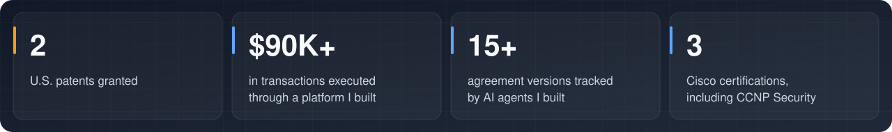
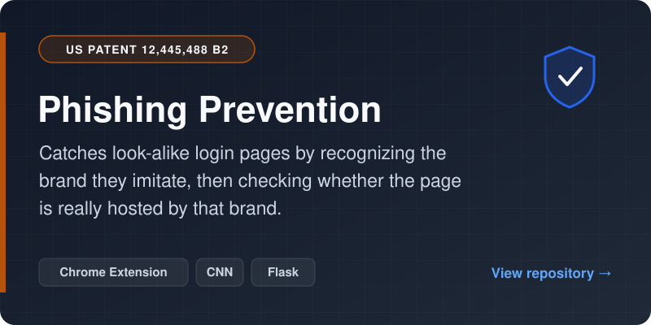
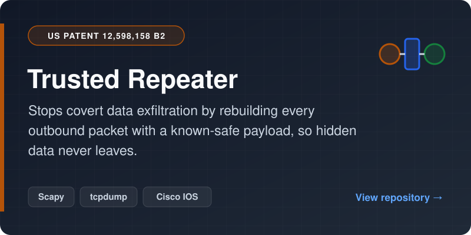
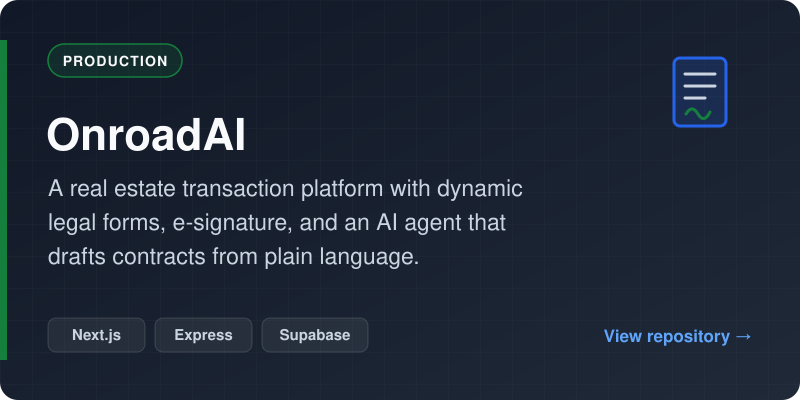
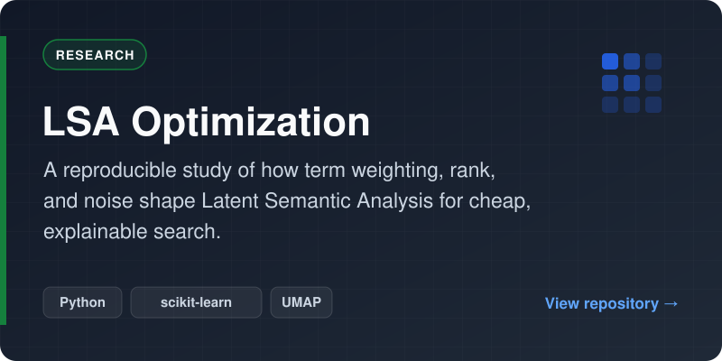

  
  
  

## About Me

I'm Karthik, a builder studying Computer Science at Penn Engineering and Finance at Wharton through the Jerome Fisher M&T Program. I like working on things with real impact: products people actually use, AI systems that do real work, and security that holds up against real attackers.

I've built a startup, shipped LLM agents into production, built multi-agent systems for investment diligence, and hold two granted U.S. patents in network security. This profile is a record of that work. Reach me at [risingonip@gmail.com](mailto:risingonip@gmail.com).

## What I've Built

- **[OnroadAI](https://github.com/risingOnIP/onroad):** a real estate transaction execution platform that helped execute $90K worth of transactions. I architected a canonical data model that standardizes 1,000+ fields across dozens of legal forms, a JSON-defined rules layer that renders intake forms dynamically, UETA-compliant e-signature, an in-browser PDF editor, and an LLM agent with tool calling that drafts contracts from plain language. Built on Next.js ([web](https://github.com/risingOnIP/onroad)), Express ([API](https://github.com/risingOnIP/onroad-express)), and Supabase, deployed on Vercel and Railway.
- **Multi-agent AI systems:** agentic document-comparison workflows that track term changes across 15+ versions of 100+ page agreements, and a diligence pipeline that runs parallel subagents across two gated tiers, with synthesizer agents passing structured artifacts through analysis, fact-checking, and synthesis.
- **Patented security systems:** phishing detection that pairs computer vision with network identity checks, and exfiltration prevention that regenerates every outbound packet with a known-safe payload. Both are featured below.
- **Enterprise network security:** 802.1X and RADIUS authentication with EAP-TLS that assigns devices to organization-specific VLANs and enforces network security policy.

## Featured Repositories

  
  

  
  

## Patent Citations

**[US 12,445,488 B2](https://patents.google.com/patent/US12445488B2/) · Phishing detection** — cited by 9 filings, including:
- **Gen Digital (Norton)**: granted patent
- **Bank of America**: granted patent
- **Korea Internet & Security Agency (KISA)**, South Korea's national cybersecurity agency: granted patent

**[US 12,598,158 B2](https://patents.google.com/patent/US12598158B2/) · Exfiltration prevention** — cited by:
- **Wiz**: granted patent
- **Mellanox (NVIDIA)**: patent application

## Writing and Speaking

- **Cloud Security Alliance:** Control Category Co-Lead in the Serverless Working Group, and co-author of the [FaaS Serverless Control Framework](https://cloudsecurityalliance.org/artifacts/faas-serverless-control-framework-set-based-on-nist-800-53-r5-controls), built on NIST 800-53 R5 controls.
- **Stanford Applied Cyber:** gave a talk on software-defined networking.
- **ISACA Now:** published the blog post [Software-Defined Networking: The Future of Networking](https://www.isaca.org/resources/news-and-trends/isaca-now-blog/2023/software-defined-networking-the-future-of-networking).
