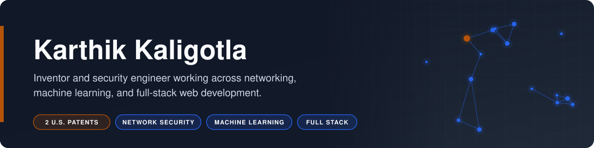

# Karthik Kaligotla

**Inventor and security engineer working across networking, machine learning, and full-stack web development.**

       

Karthik Kaligotla is the named inventor on two granted U.S. patents: one for detecting phishing pages by combining visual brand recognition with network identity checks, and one for preventing data exfiltration by regenerating outbound packets with known-safe payloads. His work spans browser extensions and CNN inference services, Cisco network engineering and packet crafting, applied linear algebra for text retrieval, and modern React full-stack development. Each repository below documents the problem it addresses and the outcome it delivers.

## Focus Areas

- **Security invention:** phishing detection and exfiltration prevention, both patented.
- **Network engineering:** policy-based routing, packet capture, and packet regeneration.
- **Machine learning:** CNN brand classification and LSA text representations.
- **Full-stack web:** Next.js App Router, Server Actions, Prisma, and PostgreSQL.

## Patented Work

| Project | What It Does | Patent | Stack |
|---|---|---|---|
| [Phishing Prevention](https://github.com/risingOnIP/phishing-prevention) | Flags look-alike phishing pages by recognizing the imitated brand and verifying hosting IPs | [US 12,445,488 B2](https://patents.google.com/patent/US12445488B2/) | JavaScript, Python, TensorFlow |
| [Trusted Repeater](https://github.com/risingOnIP/trusted-repeater) | Destroys covert exfiltration channels by regenerating outbound packets with known-safe payloads | [US 12,598,158 B2](https://patents.google.com/patent/US12598158B2/) | Python, Scapy, Cisco IOS |

## Research

| Project | What It Does | Stack |
|---|---|---|
| [LSA Optimization](https://github.com/risingOnIP/lsa-optimization) | Measures how weighting, rank, and noise affect Latent Semantic Analysis on 20 Newsgroups | Python, scikit-learn, UMAP |

## Full-Stack Foundations

| Project | What It Does | Stack |
|---|---|---|
| [To-Do Web App](https://github.com/risingOnIP/to-do-web-app) | A minimal full-stack task list built with Next.js Server Components, Server Actions, and Prisma. | Next.js, Prisma, SQLite |
| [Next.js Dashboard (Learning Project)](https://github.com/risingOnIP/nextjs-dashboard-course) | Working through the official Next.js App Router course: fonts, images, layouts, and a Postgres-backed dashboard. | Next.js, TypeScript, PostgreSQL |

## Contact

For patent licensing or collaboration inquiries, reach out through [GitHub](https://github.com/risingOnIP).
